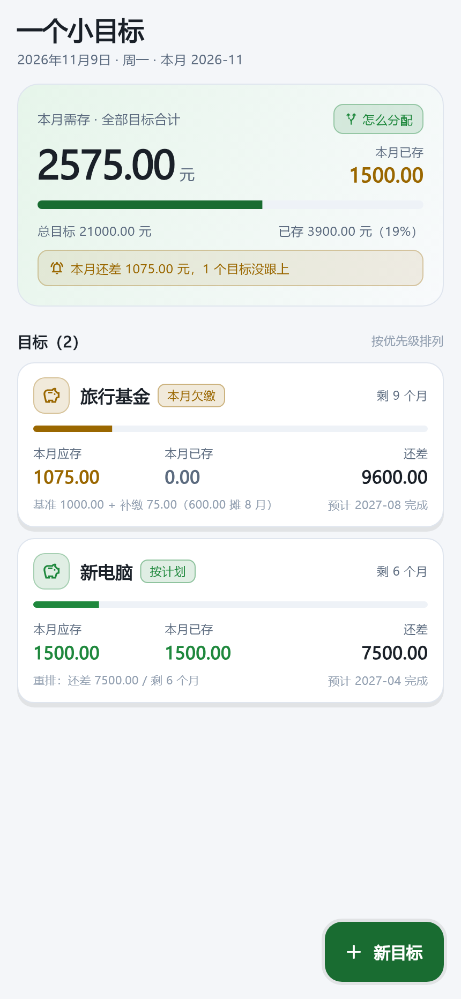
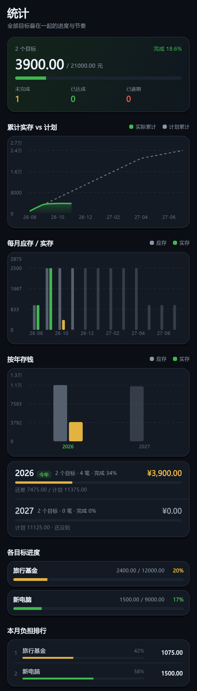
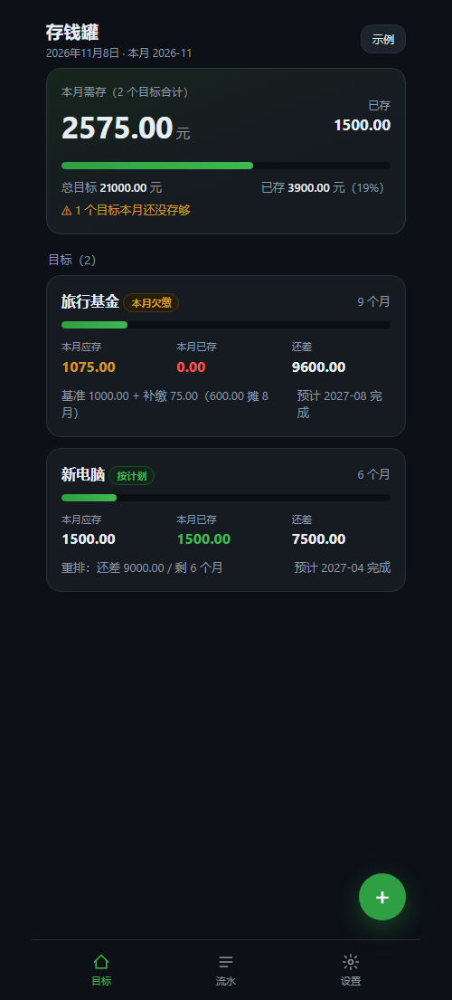
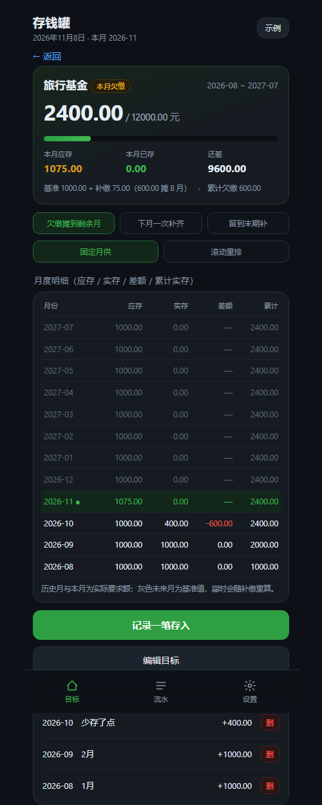
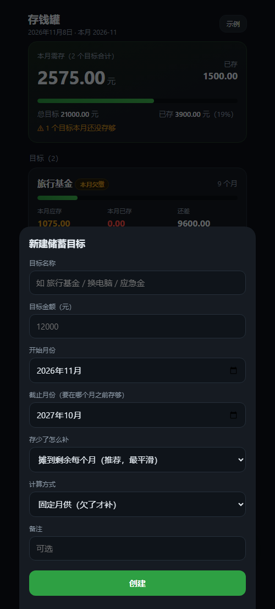

# 一个小目标 · Saving Goal

[](https://github.com/oskiiii516/saving-goal/actions/workflows/build-apk.yml)
[](LICENSE)
[](#)

> 作者：**兮狐**（QQ 1015687519）· 许可证 MIT
>
> 一句话：这是一个能管「每月该存多少、实际存了多少、存少了自动摊还到下个月/未来几个月、并保证在截止月前存够」的目标储蓄 App。
> 结论先行：**GitHub 上没有现成开源项目做到这件事**，核心的「欠缴摊还」算法必须自研。目前引擎 + 可交互原型已完成并可运行。

---

## 1. 需求拆解（从用户话语里抽出的 7 条功能）

| # | 需求 | 说明 |
|---|------|------|
| R1 | 多目标 | 一个 App 里同时管旅行基金、换电脑、应急金…各自独立期限 |
| R2 | 每月应存额 | 由「目标额 ÷ 期限月数」自动算出，且能取整到分 |
| R3 | 每月实存记录 | 可一笔或多笔存入，可补录历史月份 |
| R4 | 欠缴识别 | 某月没存够 → 系统知道「欠了多少」 |
| R5 | 欠缴摊还 | 欠的钱在下个月或未来几个月补回来，不是无限拖 |
| R6 | 期限约束 | 到截止月必须存够；逾期则显示缺口全额催缴 |
| R7 | 全局视角 | 多个目标时，本月总共要存多少钱一目了然 |

R2 + R4 + R5 + R6 组合起来就是本项目真正的价值点——也是所有现成项目缺的那块。

---

## 2. 开源调研结论

检索方式：GitHub 关键词 `savings goal tracker` / `savings goals flutter` / `piggy bank goal app` / `目标储蓄`，按 star 与最近推送排序，逐个看 README 与源码目录结构（约 3007 条命中，看完前 10 页 + 全部 star>20 的项目）。

### 2.1 代表项目

| 项目 | 技术栈 | ★ | 现状 | 有没有「欠缴摊还」 |
|------|--------|---|------|------------------|
| [davefaliskie/travel_treasury](https://github.com/davefaliskie/travel_treasury) | Flutter | 306 | 教程类项目，MIT | ❌ 只有总进度 |
| [Mufaddal5253110/BudgetBudy](https://github.com/Mufaddal5253110/BudgetBudy) | Flutter | 53 | 2021 后停更 | ❌ |
| [Kanjo-Elkamira-Ndi/PiggyVest](https://github.com/Kanjo-Elkamira-Ndi/PiggyVest) | Flutter + Node + Postgres | 19 | 2025-09 最后推送 | ❌ 需自建后端 |
| [heditrigui/coinly](https://github.com/heditrigui/coinly) | Kotlin / Compose | 6 | 2026-10 新建，MIT | ❌ 预算类，无目标期限 |
| [fgr966779-rgb/piggyvault-app](https://github.com/fgr966779-rgb/piggyvault-app) | Flutter + Drift + Hive | 少 | 赛博朋克 UI | ❌ 双目标游戏化 |
| ChawlaaG/savebox, OguzAytar/kumbara, Priscy12-p/savesmart, sharmas1ddharth/PaisaFlow, Ankit180898/spendify | Flutter + SQLite | 0–3 | 学生练手/骨架 | ❌ |

### 2.2 共性缺陷（几乎全部命中）

1. **只有「目标总额 + 已存 + 进度条」**：本质是个带进度显示的计算器。
2. **没有时间维度**：不记录「这个月该存多少」，因此无法判断「本月欠了」。
3. **没有欠缴概念**：存少了只是进度条慢，没有任何补救机制。
4. **没有期限约束**：要么无截止日，要么有截止日却不参与计算。
5. UI 大多直接抄记账 App 模板，目标详情页只有一张环形图。

### 2.3 商业产品参照

- **YNAB – "Needed for Spending" target**：给定金额 + 日期，自动算每月要预留多少；有"本月不足额"提示，但没有把缺口滚入后续月份的显式算法。
- **Actual Budget – category goal (sinking fund)**：按剩余月数均摊（等价于本项目的 rebase 模式），达标率靠手工调整。
- **Monarch / Copilot**：同类，均为订阅制 Web/移动端，离线不可用。

结论：**这两个产品的"滚动重排"思路可以借鉴，但"欠缴在上月末结算 + 三种补缴策略"这套机制，市面上无论开源还是商业都没直接可抄的实现。→ 自研。**

---

## 3. 本项目与它们的差异（一句话卖点）

> 大多数存钱 App 告诉你「离目标还差多少」；
> 这个 App 告诉你「**这个月必须存 1357.15，因为你上个月欠了 600，我把它摊到了剩下的 8 个月里**」。

---

## 4. 算法设计（核心资产）

### 4.1 两条铁律

1. **金额一律用「分」的整数运算**，永不出现浮点。`¥1000.00 → 100000`。
2. **时间一律转成绝对月序号**：`ymIndex('2026-11') = 2026*12 + 10 = 24322`，月份加减、比较、差值全部是整数。

### 4.2 基准时间表 `buildSchedule`

```
n         = 期限月数（含首尾）
remaining = target − initial        ← initial = 期初已存（建目标前就有的钱）
per       = floor(remaining / n)
第 1..n-1 月 = per
第 n 月       = per + (remaining - per*n)     ← 余数全部给最后一月
```

例：`¥1000.00 / 3 月` → 333.33 + 333.33 + **333.34**
例：`¥1000.01 / 3 月` → 333.33 + 333.33 + **333.35**
保证 `Σ schedule == remaining`，加上期初已存后 `initial + Σ schedule == target`，永不丢分。

**期初已存为什么不记在某个月**：它是「开始之前就已经在账上的钱」，记进某个月会让那个月的明细凭空多出一笔存入。所以它是 `SavingsGoal.initialCents` 字段，只做两件事——把要摊的总额减掉，以及在算欠缴时视作「一开始就领先」。

### 4.3 关键取舍：欠缴在「上月末」结算

```
arrears = Σ schedule[0 .. 上月]  −  Σ deposits[开始月 .. 上月]
```

**本月存入只影响"是否达成"，不改变本月的目标额。**

为什么这样设计（踩过坑）：最初版本用「`ceil(还差 ÷ 剩余月数)`」直接当本月应存，结果是本月已存够 1000 元、系统仍要求再存 909 元——因为把本月刚存的钱又摊薄进去了。改成"上月末结算"后：

- 历史月份的「应存」永久固定，明细表不会因为后来补缴而漂移；
- 本月目标额 = 本月基准额 + 补缴额，语义清晰可解释；
- 用户看到的是「这个月该存多少」，而不是一个每月都在变的平均数。

### 4.4 两种计算模式

| 模式 | 公式 | 适用 |
|------|------|------|
| `schedule` 固定月供（默认） | 本月应存 = 基准额 + 补缴额 | 想要稳定月供、欠了才补的人 |
| `rebase` 滚动重排 | `ceil((target − 上月累计实存) ÷ (剩余月数 − 宽限月))` | 收入不稳定、接受月供浮动的人 |

`rebase` 的好处：某个月多存了 5000，后面系统自动把月供降下来（实测 12000/12 月，2 月一次存 5000 → 3 月起每月只要 600）。

### 4.5 三种补缴策略（`arrearsMode`）

| 策略 | 行为 | 实测（欠 2500，剩 7 月，基准 1000） |
|------|------|-----------------------------------|
| `spread` 摊到剩余月（默认） | `ceil(arrears ÷ 可摊月数)` | 本月 1357.15 |
| `catchUpNow` 下月一次补齐 | 补缴额 = 全部欠款 | 本月 3500.00 |
| `tail` 留到末期 | 补缴额 = 0，末期一次性还 | 本月 1000.00 |

`spread` 是对用户最友好的一种：欠 600 摊到 8 个月，每月只多 75 元，几乎无痛。

### 4.6 状态机

| 状态 | 条件 | UI 表现 |
|------|------|---------|
| `done` 已完成 | 累计实存 ≥ 目标 | 蓝色，显示超出金额 |
| `overdue` 已逾期 | 当前月 > 截止月且未达标 | 红色，缺口全额催缴 |
| `notStarted` 未开始 | 当前月 < 开始月 | 灰色，显示开始日期 |
| `onTrack` 按计划 | 本月实存 ≥ 本月应存 | 绿色 |
| `behind` 本月欠缴 | 本月实存 < 本月应存 | 黄色 + 补缴说明 |

### 4.7 边界与不变量（全部有测试守着）

- 期限 1 个月：全额在当月。
- 末期一分未存：本月应存 = 缺口全额。
- 多存（超额）：状态转 `done`，多余金额单独展示，不倒扣。
- 中途改目标金额：以新目标重算，已存金额不清零。
- `Σ 每月应存 == 目标额`（误差 0 分）。
- 空目标 / 已删除目标 / 跨年（12 月 → 次年 1 月）均正确。

### 4.8 实测基线（可作为验收用例）

目标 ¥12000 / 2026-01 ~ 2026-12，基准月供 ¥1000：

| 场景 | 本月应存 | 状态 |
|------|---------|------|
| 按时存 | 1000.00 | onTrack |
| 2 月只存 500 | 1000.00（实存 500） | behind |
| 拖到 5 月（已存 1500，欠 2500，摊 7 月） | 1357.15 | behind |
| 同上 + catchUpNow | 3500.00 | behind |
| 同上 + tail | 1000.00 | behind |
| 末期一分未存 | 12000.00 | behind |
| rebase + 2 月存 5000 | 600.00（3 月起） | onTrack |
| 逾期 | 9000.00（缺口全额） | overdue |
| 宽限 0 月 / 宽限 2 月（欠 500，剩 9 月） | 1250.00 / 1333.34 | behind |

---

## 5. 当前产物

```
D:\dev\saving-goal-app\            # 注意：真实路径必须是纯英文，中文路径会让 build_runner 崩
├── app/                       # Flutter App（路线 A，主力产物）
│   ├── lib/core/engine.dart        # Dart 版引擎，与 JS 版逐行对应
│   ├── lib/core/allocate.dart      # 智能补缴：把一笔预算按优先级分到各目标
│   ├── lib/core/settings.dart      # 主题/提醒偏好模型
│   ├── lib/data/{database,repository}.dart  # drift + SQLite（schemaVersion 2）
│   ├── lib/services/reminder_service.dart   # 本地通知（月度重复）
│   ├── lib/state/providers.dart    # Riverpod 数据流 + SettingsController
│   ├── lib/ui/                     # 首页/统计/设置/详情/表单/图表/调色板
│   ├── test/engine_test.dart       # 19 个算法断言
│   ├── test/allocate_test.dart     # 7 个分配断言
│   ├── test/widget_test.dart       # 4 个组件测试
│   └── test/preview_golden_test.dart  # 4 张真机尺寸 golden 预览
├── engine/
│   ├── savings-engine.mjs     # 纯函数引擎，零依赖，13 组断言全绿
│   └── engine.test.mjs        # node engine.test.mjs
├── prototype/
│   ├── index.html             # 单文件可交互原型（手机尺寸，localStorage 持久化）
│   └── screenshot.mjs         # CDP 截图脚本（headless 验证用）
├── screenshots/               # 界面预览图
└── README.md
```

> `D:\deepseek\其他\saving-goal-app` 是指向 `D:\dev\saving-goal-app` 的 Junction，
> 两个路径看到的是同一份文件；**但所有构建命令必须在英文路径下执行**（见 5.3）。


### 界面预览

v1.1（Flutter 真机截图来自 golden test，430×932 @2x）：

| 目标列表（深色） | 目标列表（浅色） | 统计（图表） | 目标详情 |
|---|---|---|---|
|  |  |  |  |

早期 Web 原型（route B 的验证产物，交互逻辑与算法一致）：

| 目标列表 | 目标详情 | 新建目标 |
|---|---|---|
|  |  |  |

### 跑起来

```bash
# 引擎测试
cd saving-goal-app/engine && node engine.test.mjs

# 原型（任一方式）
cd saving-goal-app/prototype && python -m http.server 8765
# 浏览器打开 http://127.0.0.1:8765
# 或直接双击 index.html（file:// 也能用，引擎已内联）
```

原型已实现：目标列表 / 本月合计负担 / 目标详情（月度明细表：应存·实存·差额·累计实存）/ 三种补缴策略切换 / 两种计算模式切换 / 存入与补录 / 流水 / 数据导出 / 示例数据。
已用 headless Chrome 逐屏验证渲染与交互（3560 元级数字、状态色、明细行、表单弹层均正常）。

---

## 5.3 Flutter App（路线 A，主力产物）

### 环境（全部在 D 盘，C 盘零占用）

| 组件 | 位置 | 备注 |
> 下表是作者本机的安装位置（Windows），**换台机器不用照抄**，装好 Flutter + Android SDK 后 `flutter doctor` 通过即可。镜像地址是国内网络下的实测结果，供参考。

|---|---|---|
| Flutter 3.47.9 / Dart 3.13.7 | `D:\dev\flutter` | 从 `storage.flutter-io.cn` 下的 zip，官方源约 15KB/s 不可用 |
| Android SDK（platform-tools 37.0.2、platforms 35/36、build-tools 35/36） | `D:\dev\android-sdk` | 走 `mirrors.cloud.tencent.com/AndroidSDK/`，`dl.google.com` 直连不通 |
| pub 缓存 | `D:\dev\pub-cache` | `PUB_CACHE` |
| gradle 缓存 | `D:\dev\gradle` | `GRADLE_USER_HOME` |
| JDK | 系统自带 Microsoft JDK 21 | 未额外安装 |

作者本机把上面这些变量写在 `env.sh` 里，新开终端先 `source env.sh`。你如果已经把它们加进系统环境变量，这一步可以跳过。

镜像已配：`FLUTTER_STORAGE_BASE_URL=https://storage.flutter-io.cn`；`android/gradle/wrapper/gradle-wrapper.properties` 指向腾讯 gradle 镜像；`android/settings.gradle.kts` + `android/build.gradle.kts` 里 maven 优先阿里云。

### 依赖选型

- **drift + drift_flutter**：类型安全 SQLite，编译期生成 DAO；不手写 SQL 字符串
- **flutter_riverpod**：数据流（DB stream → 计算结果 → UI），避免手写 `setState` 树
- **fl_chart**：统计页的累计曲线与月度柱状图，纯 Dart 无需原生依赖
- **flutter_local_notifications + timezone + flutter_timezone**：月度提醒。用 `zonedSchedule` + `matchDateTimeComponents: dayOfMonthAndTime` 做「每月某日某时」重复提醒，`androidScheduleMode: inexactAllowWhileIdle` 是为了不申请 `SCHEDULE_EXACT_ALARM`（省电策略允许几分钟偏差，存款提醒不需要秒级精度）
- **shared_preferences**：主题模式、提醒开关/日期/时间这类偏好设置
- **intl / flutter_localizations**：中文日期与本地化控件
- 没有引第三方「目标进度」轮子——调研结论里那些项目都没有欠缴摊还，核心算法只能自己写

### 已实现

| 需求 | 实现位置 |
|---|---|
| 增加目标（名称/金额/起止月/策略/备注） | `ui/goal_form_sheet.dart` |
| **反向规划：只填「每月能存多少」，自动算出需要几个月 / 哪天完成** | `ui/goal_form_sheet.dart` 的 `_PlanMode.byMonthly` + `engine.monthsNeeded` / `deadlineFor` |
| **每个目标单独设「每月几号存」，当天提醒** | `GoalRow.payDay` + `services/reminder_service.dart` 的 `syncGoalReminders`（通知 id 段 2000–2039） |
| **主页左滑目标卡：取消 / 编辑 / 删除** | `ui/goals_page.dart` 的 `_SwipeableGoalTile`（`flutter_slidable`，右滑或点卡片外自动收回） |
| **建目标时填「已经存了多少」，只把剩下的摊进月供** | `SavingsGoal.initialCents` + `buildSchedule()`（v1.2 加，schemaVersion 3） |
| 每月应存多少（自动算） | `core/engine.dart` `compute()` |
| 实际存了多少（可补录历史月） | `ui/deposit_form_sheet.dart` |
| 存少了往后补（摊平/一次补齐/留末期） | `compute()` 的 `arrearsMode` 分支 |
| 期限内完成（进度、预计完成月、逾期） | `GoalComputation.status / projectedFinishYm` |
| 多目标本月合计负担 | `aggregate()` + 首页顶部汇总卡 |
| **月度提醒到日子催存** | `services/reminder_service.dart` + `ui/settings_page.dart` |
| **累计曲线 / 每月应存柱状图** | `ui/charts.dart`（`CumulativeChart` / `MonthlyBarChart`）+ 统计页 |
| **按年统计：每年应存 / 实存列表 + 年度柱状图** | `engine.yearlySummary()` → `YearSummary`；`ui/charts.dart` 的 `YearlyBarChart` + `ui/insights_page.dart` 的 `_YearRow` |
| **智能补缴分配（按优先级）** | `core/allocate.dart` + `ui/allocation_sheet.dart`，目标带 `priority` 字段可排序 |
| **深色 / 浅色 / 跟随系统** | `ui/palette.dart`（`ThemeExtension`）+ `ui/theme.dart`，切换在设置页 |
| 数据本地持久化 | drift `saving_goal` 数据库，schemaVersion 4（v1.1 加 `priority`、v1.2 加 `initial_cents`、v1.3 加 `pay_day`，都带迁移） |
| 应用名/图标/深色启动页 | `android/.../AndroidManifest.xml`（label=一个小目标）、`assets/icon/make_android_icons.py`、`res/drawable/launch_background.xml` |

### 智能补缴是怎么算的（`core/allocate.dart`）

给一个「这个月我能拿出这么多钱」的预算，规则对用户可解释，不用黑箱权重：

1. 顺序 = 优先级顺序（列表已按 `priority` / 逾期程度排好）
2. 第一轮：谁本月还欠多少就先给谁补满，给到预算见底为止
3. 第二轮：还有富余，按「离目标总额还差多少」的比例提前预存，每个目标最多预存到缺口为止，绝不出现建议超过剩余目标
4. 预算大于总缺口时，多出来的钱原样留着（`unassignedCents`）

点「按这个方案记账」会一次性写入多笔存款（`repository.addDepositsBatch`），不是改余额。

### 构建

```bash
cd app                             # 仓库根目录下的 app/

flutter pub get
flutter test                       # 54 tests（算法 31 + 分配 7 + 组件 4 + 视觉 7）
flutter test test/preview_golden_test.dart --update-goldens   # 重新生成 test/golden/*.png
flutter build apk --release        # 产物 build/app/outputs/flutter-apk/app-release.apk
```

> **Windows 用户注意**：`build_runner` 在含中文的路径下会 AOT 编译失败（`Unable to write file ... build.dart.aot`），把仓库放在纯英文路径下再构建。

产物：`app-release.apk`，约 63 MB（universal，含 arm / arm64 / x64 三个 ABI 的 sqlite3）。
要小体积可 `flutter build apk --release --split-per-abi`，arm64 单独约 20 MB。

装到手机（打开 USB 调试后插线）：

```bash
flutter devices
flutter install --release
```

### 踩过的坑

1. **中文路径会让 build_runner 的 AOT 编译失败**：报 `Unable to write file: ...\.dart_tool\build\entrypoint\build.dart.aot`。
   结论：Dart/Flutter 工具链在 Windows 上对非 ASCII 路径处理有缺陷。已把工程迁到 `D:\dev\saving-goal-app`，中文路径只留 Junction。**任何时候在中文路径下执行 `flutter pub run build_runner` 都会复现。**
2. **`drift_dev` 生成目录名**：SDK 35/36 的 zip 内部叫 `android-15`/`android-16`，解压后要改名成 `android-35`/`android-36`，否则 sdkmanager 不认。
3. **gradle 9.3.1 + AGP 9.1.0** 是 Flutter 3.47 模板的默认组合，老教程里的 8.x 配置不能照抄。
4. **Windows 桌面构建需要开发者模式**（插件 symlink），本机没开，所以只出 Android 包。
5. **sqlite3 的 native assets hook 会去 github.com 下载 `.so`**，国内必然超时：报 `Target build_hooks failed` / `Failed to download ... libsqlite3.arm.android.so`。
   关掉 native assets 也不行（`flutter config --no-enable-native-assets` 会报「sqlite3 require the dart assets feature」），降级到 3.4.0 也一样（3.x 全带 hook）。
   解法：把 hook 的下载地址改写成 GitHub 加速镜像 —— `bash tools/patch-pubcache-mirror.sh`（默认 `https://gh-proxy.com/`，实测可用；`ghfast.top`、`ghproxy.net`、`gh.llkk.cc` 当时均无响应）。
   改的是 `$PUB_CACHE/hosted/pub.dev/sqlite3-*/lib/src/hook/compile/description.dart` 里的 `defaultUrlPattern`，属于对第三方便利性补丁，`pub cache repair` 或升级版本后需重跑。
6. **PIL 画带 alpha 的图形会覆盖而不是混合**：给 RGBA 图直接 `fill=(r,g,b,10)` 会把 alpha 写成 10，整张图几乎全透明。要先画到独立图层再 `Image.alpha_composite`（`assets/icon/make_icon.py` 里有注释）。
7. **`flutter_local_notifications` 23.x 要求 compileSdk 37，而 AGP 只认 `android-37` 这个名字**：sdkmanager 自动装下来的目录叫 `platforms/android-37.0`（package.xml 里 `path="platforms;android-37.0"`、`<api-level>37.0</api-level>`），AGP 找 `hash string 'android-37'` 永远找不到，报 `Failed to find target with hash string 'android-37'`。
   修法（手工一次性）：把目录 `mv android-37.0 android-37`，并把 `source.properties` 的 `AndroidVersion.ApiLevel=37.0` → `37`、`package.xml` 里 `path="platforms;android-37.0"` → `"platforms;android-37"`、`<api-level>37.0</api-level>` → `37`；`sdkmanager --list` 能列出 `platforms;android-37` 即算修好。
8. **compileSdk 37 还要配套开脱糖**：`app/build.gradle.kts` 必须 `compileSdk = 37` + `isCoreLibraryDesugaringEnabled = true` + `dependencies { coreLibraryDesugaring("com.android.tools:desugar_jdk_libs:2.1.4") }`，否则报 `Dependency ':flutter_local_notifications' requires core library desugaring` 和 `androidx.core:core-ktx:1.19.0 requires compileSdk 37`。


## 6. 做成 App 的三条路线

| 路线 | 工作量 | 优点 | 缺点 |
|------|--------|------|------|
| **A. Flutter 原生（推荐长期）** | 中（3–5 天起步） | 双端一套代码、性能好、SQLite/本地通知/桌面小组件都顺 | 本机需装 Flutter SDK（当前没有） |
| **B. Capacitor 套壳现有 Web 原型** | 小（半天出 APK） | 现在就能装到手机上试，UI 已现成 | iOS 需 Mac 签名；原生能力弱 |
| **C. 先 B 后 A** | 小 + 中 | 先拿到可装机的 MVP 验证真实使用习惯，再决定是否重写 | 要维护两份 UI（但引擎可 1:1 移植） |

推荐 **C**：引擎是纯函数 + 整数分运算，JS → Dart 是逐行翻译，`buildSchedule` / `computeGoal` 两个函数搬过去就完事，不会白写。

### 6.1 Flutter 版结构（路线 A/C 的落地蓝图）

```
lib/
├── core/engine.dart          # computeGoal / buildSchedule（移植自 savings-engine.mjs）
├── data/
│   ├── db.dart               # Drift 数据库
│   ├── goal_dao.dart
│   └── deposit_dao.dart
├── features/
│   ├── goals/                # 目标列表 + 本月合计
│   ├── goal_detail/          # 明细表 + 补缴策略切换
│   ├── deposit/              # 存入/补录
│   └── settings/
└── main.dart
```

依赖：`drift` + `sqlite3_flutter_libs`（本地库）、`intl`（货币/日期）、`fl_chart`（可选图表）、`flutter_local_notifications`（月度提醒）。

### 6.2 数据模型（SQLite）

```sql
CREATE TABLE goal (
  id            TEXT PRIMARY KEY,
  name          TEXT NOT NULL,
  target_cents  INTEGER NOT NULL,      -- 分，整数
  start_ym      TEXT NOT NULL,         -- '2026-11'
  deadline_ym   TEXT NOT NULL,
  model         TEXT NOT NULL DEFAULT 'schedule',   -- schedule | rebase
  arrears_mode  TEXT NOT NULL DEFAULT 'spread',     -- spread | catchUpNow | tail
  grace_months  INTEGER NOT NULL DEFAULT 0,
  note          TEXT,
  archived      INTEGER NOT NULL DEFAULT 0,
  created_at    INTEGER NOT NULL
);

CREATE TABLE deposit (
  id           TEXT PRIMARY KEY,
  goal_id      TEXT NOT NULL REFERENCES goal(id) ON DELETE CASCADE,
  ym           TEXT NOT NULL,          -- 归属月份，支持补录
  amount_cents INTEGER NOT NULL,
  note         TEXT,
  created_at   INTEGER NOT NULL
);
CREATE INDEX idx_deposit_goal_ym ON deposit(goal_id, ym);
```

不存「每月应存额」——它永远由引擎现算。存下来就会和实际存入失配，这是所有记账 App 的经典脏数据来源。

---

## 7. 里程碑

| 阶段 | 内容 | 状态 |
|------|------|------|
| M0 | 调研 + 算法设计 + 引擎 + 13 组测试 | ✅ 完成 |
| M1 | 可交互 Web 原型（列表/详情/存入/流水/导出） | ✅ 完成 |
| M2 | Flutter 版：Drift 落库、引擎移植、原生 UI、真机 APK | ✅ v1.0.0 |
| M3 | 月度提醒通知、统计图表、智能补缴分配、深浅主题 | ✅ v1.1.0 |
| M3.5 | 期初已存：建目标时填「已经存了多少」，剩下的按月摊 | ✅ v1.2.0 |
| M3.6 | 主页卡片左滑操作（取消/编辑/删除） | ✅ v1.2.1 |
| M3.7 | 反向规划（按月供推期限） | ✅ v1.3.0 |
| M3.8 | 每目标「每月几号存」+ 当天提醒 | ✅ v1.3.0 / v1.3.1 |
| M3.9 | 品牌化：改名「一个小目标」+ 新图标 + 关于页 | ✅ v1.4.0 |
| M3.10 | 按年统计（年度应存/实存列表 + 年度柱状图） | ✅ v1.5.0 |
| M4 | 桌面小组件「本月还差 X 元」、补缴预览（改数字看未来月供） | ⬜ 待做 |
| M5 | 可选：WebDAV 同步、多币种、CSV 导入导出、备份还原 | ⬜ 待做 |

### 版本历史

- **v1.5.0**（2026-11）
  - **按年存钱**：统计页新增「按年存钱」区块 —— 上面一张年度双柱图（灰=应存、绿/橙=实存，今年高亮），下面逐年一行：`2026 今年 · 2 个目标 · 4 笔 · 完成 34% · ¥3,900.00`，再跟一条进度条和「还差 X / 计划 Y」；未来年份显示「计划 X · 还没到」
  - **年度计划额用基准口径**（`buildSchedule`），不是「含补缴的应存」：否则一笔老欠缴会把当年计划额撑大、年度进度永远显示没达成。这条取舍写进了 `engine.dart` 的注释，有 5 组测试守着（`[20]`–`[24]`）
  - **期初已存不计入任何一年**：那是建目标之前就有的钱，年度「实存」只算当年新存进去的
  - 只有流水、没有计划年份（比如补录了去年的存入）也会单独列出来
- **v1.4.0**（2026-11）
  - **改名「一个小目标」**（应用名、启动页、通知文案、关于页统一）
  - **新图标**：深色底 + 绿色 3/4 进度环 + 中心圆点（`assets/icon/make_icon_ring.py`，4x 超采样 + 渐变分段 + 圆头收口），补了 Android 8+ 的自适应图标（`mipmap-anydpi-v26/ic_launcher.xml` + `ic_launcher_foreground` 五个密度，前景缩到 60% 保证不被启动器遮罩裁到）
  - **关于区块**：作者 兮狐、QQ 1015687519（点一下复制）、版本号、算法一句话说明
  - 修了一个真问题：`Panel` 里放 `ListTile` 时水波纹被底色挡住（debug 下直接断言报错），统一在 `Panel` 内部包一层透明 `Material` 解决
- **v1.3.1**（2026-11）
  - 在目标表单里设了「每月几号存」就自动打开提醒总开关（并顺带申请通知权限），免得设了日子却不响
- **v1.3.0**（2026-11）
  - **反向规划**：新建目标时可选「先定月供」，只填每月能存多少 + 开始月份，自动算出需要几个月、哪个月完成（`200000 / 5000 → 40 个月，2030-02`），直接写进截止月
  - **每月存钱日**：每个目标可设 1–28 号，当天单独推送「米车：该存钱了 / 今天该存 15000.00 了（还差 120000.00）」
  - 全局汇总提醒与目标级提醒分开调度（id 1001 一条汇总，2000+ 每目标一条），关掉总开关时一起取消
- **v1.2.1**（2026-11）
  - 主页目标卡左滑露出「取消 / 编辑 / 删除」三个操作，右滑或点一下自动收回
  - 删除走确认对话框，说明会连流水一起删掉；同一时刻只允许一张卡展开（`SlidableAutoCloseBehavior` + `groupTag`）
  - 引入 `flutter_slidable`（不手写手势识别，滚动/回弹/自动关闭都由库处理）
- **v1.2.0**（2026-11）
  - 期初已存：新建/编辑目标时可填「一开始已经存了多少钱」，月供按 `(目标额 − 已存) ÷ 月数` 摊开
  - 期初已存在欠缴结算里视作「一开始就领先」，能先抵掉前面没存的月份
  - 月度明细的「累计实存」从期初已存起算；详情页显示「其中期初已存 X（不在月度明细里）」
  - 数据库 schemaVersion 2 → 3（`initial_cents` 列，带迁移，老数据不丢）
- **v1.1.0**（2026-11）
  - 月度提醒：`zonedSchedule` 每月固定日/时重复，通知内容带「本月还差 X 元，N 个目标没跟上」；重启后由 `ScheduledNotificationBootReceiver` 自动恢复
  - 统计页：累计实存 vs 计划曲线、每月应存/实存双柱状图、各目标进度、本月负担排行
  - 智能补缴：给一个预算，按优先级先补本月缺口、再按缺口比例预存，绝不超目标；一键批量记账
  - 深色/浅色/跟随系统主题（`Palette` ThemeExtension），整体视觉重构：渐变 hero 卡、图标徽章、进度条动画、金额等宽数字
  - 目标支持优先级排序（`priority` 列 + 迁移）
- **v1.0.0**（2026-11）
  - 引擎 + Drift + Riverpod + 首页/详情/表单，自绘图标与深色启动页

## 8. 风险与注意

- **补缴不能悄悄变**：任何一次策略/金额改动都要在详情页明确写出「为什么这个月是 1357.15」。可解释性是这个 App 的生命线。
- **取整误差**：全部用分做整数，`Σ schedule == target` 是硬约束，别用 `double` 算钱。
- **跨月边界**：用户 12 月 31 日 23:59 存钱，要按本地时区归到 12 月，别用 UTC。
- **补录历史月份**：要允许，且补录后当前月应存额应立刻变（因为欠缴结算变了）——这是特性不是 bug。
- **别做自动扣款**：涉及支付通道、合规与信任成本，先做「手动记账 + 提醒」。
